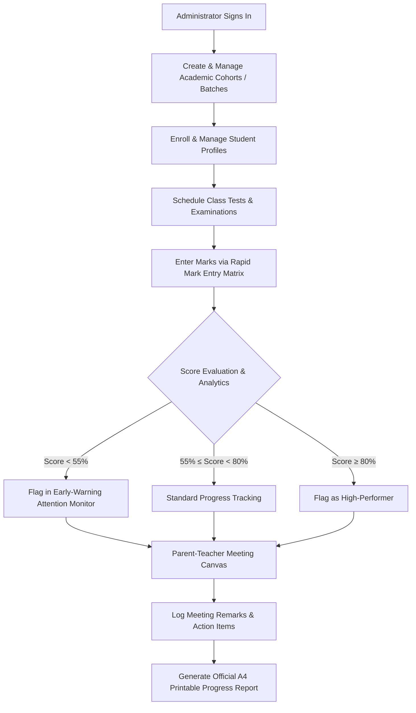
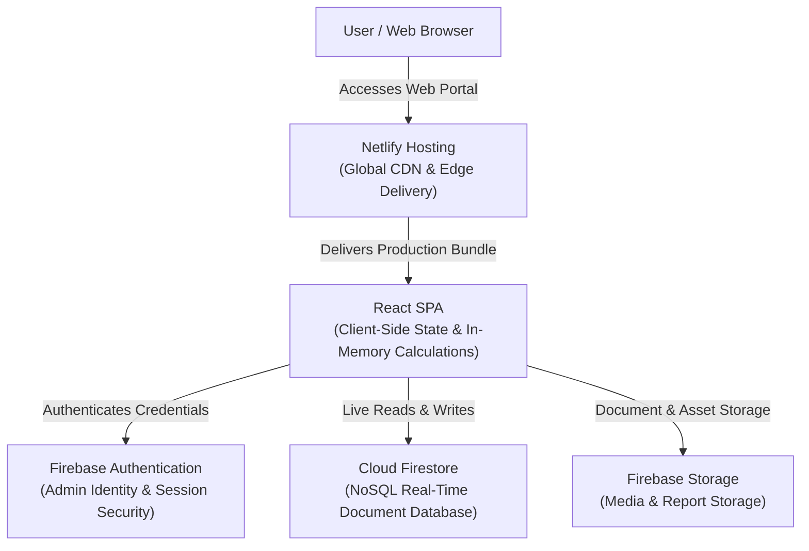

# Sky Learning Centre

An institutional academic performance portal engineered to digitize student records, streamline continuous mark entry, track longitudinal progress analytics, and generate professional print-ready report cards for coaching centers and educational academies.

---

## 1. Overview

**Sky Learning Centre** is a centralized administrative performance portal designed to replace fragmented spreadsheets and paper registers with a secure, real-time digital system of record. Built for coaching centers, tuition academies, and secondary school educators, the platform enables administrators to manage multiple academic cohorts, run longitudinal score analytics, pinpoint at-risk learners early, and conduct data-informed parent-teacher conferences.

---

## 2. The Problem

Educational academies and coaching institutes manage hundreds of students across diverse curriculum boards, yet administrative workflows frequently rely on fragile, disconnected tools:
* **Fragmented Data Storage:** Student performance records are divided across physical ledgers, disparate spreadsheet files, and messaging threads.
* **Delayed Interventions:** Academic struggles often remain unnoticed until final exams or board milestones, when remediation is difficult.
* **Time-Consuming Progress Reporting:** Compiling individual student evaluations, cumulative averages, and historical test trends for parent meetings requires hours of manual calculation.
* **Error-Prone Mark Entry:** Manual data entry without validation can lead to transposed numbers, exceeding test limits, and inaccurate averages.

---

## 3. The Solution

Sky Learning Centre unifies student lifecycle tracking, multi-cohort management, and continuous examination recording into a single, high-performance web platform. With automated in-memory calculation, instant cohort statistical benchmarks, and dedicated parent-teacher conference modes, educators can focus on instructional quality rather than spreadsheet maintenance.

---

## 4. Key Capabilities & Features

* **Executive Dashboard:** Bento grid layout presenting real-time metrics on total enrollments, active cohorts, examination averages, and batch distribution.
* **Early-Warning Attention Monitor:** Automated analytical filter highlighting students requiring intervention (< 55%) alongside high-performers (≥ 80%) across each batch.
* **Student Directory:** Searchable student directory featuring batch filters, academic badges, contact archives, and quick-action navigation.
* **Rapid Mark Entry Matrix:** Continuous spreadsheet-style continuous mark ledger with live statistical calculation, absentee toggles, and bounds checking.
* **Student 360 Profile:** Holistic academic profile detailing individual examination trajectory, milestone history, and comparative performance curves against cohort averages.
* **Milestone Journey Timeline:** Chronological event log tracking student enrollments, exam achievements, counseling notes, and parent-teacher meeting logs.
* **Parent Meeting Canvas:** Presentation mode tailored for distraction-free, focused parent-teacher discussions displaying performance analytics.
* **A4 Printable Progress Report:** Print-optimized official academic report card with institutional branding, teacher remarks, grading scales, and signature blocks.
* **Mobile Adaptive Layout:** Responsive design with slide-over navigation drawers, touch targets (≥ 44px), and adaptive input controls on handheld devices.

---

## 5. Typical Workflow

---

## 6. Tech Stack

| Layer | Technology |
| :--- | :--- |
| Frontend Framework | React 19, TypeScript, Vite |
| Styling & UI Components | Tailwind CSS, Lucide React, Motion |
| Data Analytics & Visualization | Recharts |
| Authentication | Firebase Authentication |
| Database & Real-Time Sync | Google Cloud Firestore |
| File Storage | Firebase Storage |
| Hosting & Deployment | Netlify |

---

## 7. System Architecture

Sky Learning Centre is architected as a high-performance single-page application (SPA) hosted on Netlify. All rendering, state transitions, and analytical computations occur on the client side in-memory for instant feedback and zero latency. Secure persistence and user identity are managed asynchronously via Firebase services including Authentication, Cloud Firestore, and Firebase Storage.

---

## 8. UI/UX & Design Philosophy

The application interface is crafted around high-density information architecture and rapid administrative data workflows. The visual design system incorporates clean typographic hierarchies, high contrast data tables, responsive touch targets (≥ 44px) for tablet and mobile entry, and clear visual indicators for academic status.

---

## 9. Security & Access Control

* **Strict Access Control:** Read and write access to student ledgers, examinations, and meeting archives is restricted to authenticated institute administrators.
* **Automated Inactivity Revocation:** Background session monitors protect against unauthorized access on shared office computers.
* **Client-Side Validation:** Score bounds checking ensures marks cannot exceed designated test maximums or accept malformed numerical inputs.
* **Confidential Student Records:** Student profiles, contact details, and counseling remarks are stored in private database collections with no public read permissions.

---

## 10. Impact & Results

* **Paperless Workflow:** Replaced physical paper registers and uncoordinated spreadsheets with a single digital ledger.
* **Time Savings:** Reduced preparation time for parent-teacher progress reports from hours to one click [CONFIRM: e.g. ~80% reduction in reporting time].
* **Early Academic Interventions:** Proactive identification of at-risk students scoring below passing thresholds before board or school examinations [CONFIRM: metric on student performance improvements].
* **Operational Scalability:** Easily manages multiple concurrent cohorts and hundreds of students across various curriculum boards [CONFIRM: active student/batch count].

---

## 11. Screenshots

Screenshots will be placed in an `/assets` folder.

| Screen | Description / Suggested Caption |
| :--- | :--- |
| Executive Dashboard | KPI Bento Grid showing active cohorts, average score distributions, and the early-warning attention monitor. |
| Student Directory | Searchable directory with batch filters, academic badges, and quick-action navigation. |
| Rapid Mark Entry Matrix | Spreadsheet-style continuous mark ledger with live statistical calculation and absentee toggles. |
| Student 360 Profile | Comprehensive performance analytics comparing individual test trends with cohort averages. |
| Milestone Journey Timeline | Chronological event log recording enrollments, test achievements, PTM discussions, and remarks. |
| Parent Meeting Canvas | Clean presentation mode tailored for distraction-free parent-teacher discussions. |
| A4 Printable Progress Report | Print-optimized official academic report card with institutional branding and signature blocks. |
| Mobile Adaptive Layout | Slide-over navigation drawer and responsive mobile data entry on compact screens. |

---

## 12. Demo

* **Interactive Sandbox / Live Demo:** [CONFIRM: Insert Live Demo URL if applicable]
* **Video Walkthrough:** [CONFIRM: Insert Loom / YouTube link]

---

## 13. Future Scope

* **AI-Powered Personalized Report Remarks:** Automated synthesis of student test histories to generate supportive, constructive teacher remarks for report cards.
* **Instant Parent Messaging Integration:** One-click automated distribution of test results, attendance notifications, and PTM summaries via WhatsApp or SMS.
* **Dedicated Student & Parent Portal:** Role-restricted portal access allowing students and parents to view their personal performance trends from home.
* **Daily Attendance Register:** Cohort-level daily attendance tracking correlated with test outcome analytics.
* **Tuition & Fee Management:** Integrated payment milestone logging and fee receipt generation.

---

---

## 15. Note on Source Code & Confidentiality

### Confidentiality Notice
The complete source code, proprietary business logic, and database schemas for this software are proprietary and subject to a non-disclosure agreement (NDA) as part of an active client engagement. To honor client confidentiality, the underlying code repository remains private. An architectural walkthrough, code structural details, or a live feature demonstration can be shared directly with hackathon judges upon request.

